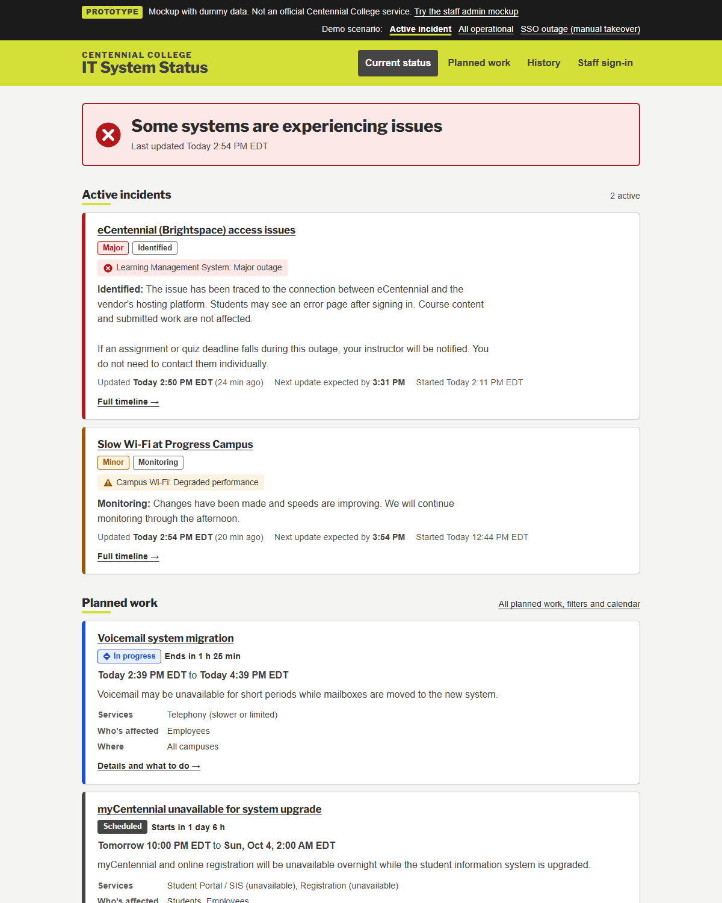
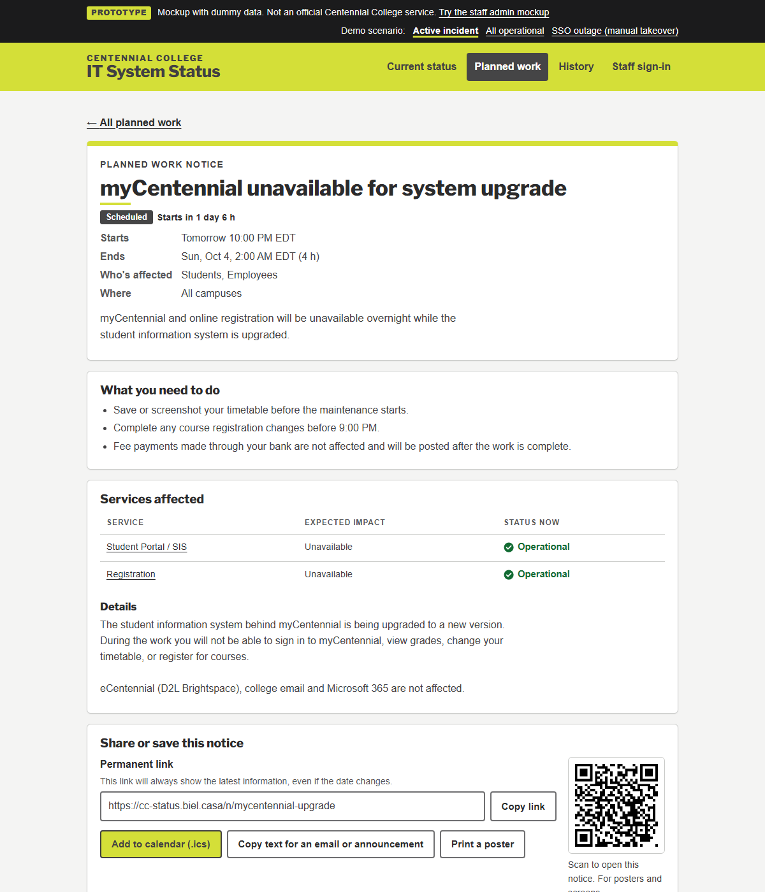
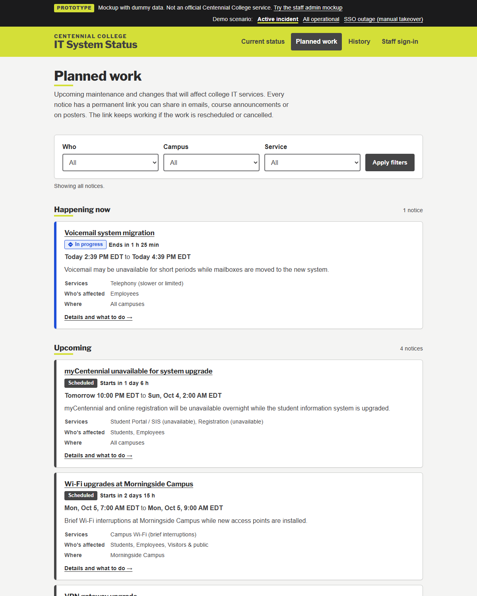

# Centennial College IT Status Page — Prototype

**Live demo: https://cc-status.biel.casa**

This is a clickable prototype of a public **IT system status page** for Centennial
College. It's a proposal for discussion, not an official college service. All
incidents, dates and contacts are dummy data.



## The problem it solves

When something big fails, such as single sign-on, the campus network, the college
website, email or ServiceNow, the usual channels for telling students and staff
are often down too. A status page that is **hosted outside college
infrastructure** and has its **own independent staff login** stays available
exactly when it's needed. It gives everyone one link to check, and it cuts the
volume of "is X down?" calls to the Service Desk.

ServiceNow would feed it automatically under normal conditions. When ServiceNow
itself is unavailable, staff can **take manual control** and keep publishing from
any internet connection.

## What to try in the demo

- **Switch scenarios** using the bar at the top: *Active incident*, *All operational*,
  and *SSO outage (manual takeover)*. The last one shows the core resilience
  case: sign-in and ServiceNow are down, and IT staff are publishing directly.
- **Planned work notices** ([example](https://cc-status.biel.casa/n/mycentennial-upgrade)).
  Each notice has a permanent short link to share in emails, eCentennial
  announcements, social posts or posters (there's a QR code). People can add it
  to their calendar. If the work is rescheduled or cancelled, the same link
  shows the change and keeps a public history of what changed.
- **Filtered, shareable views** such as
  [planned work for students](https://cc-status.biel.casa/notices.html?audience=students),
  and an **embeddable widget** that department sites or eCentennial can show.
- **Staff admin mockup** ([`/admin/`](https://cc-status.biel.casa/admin/)). Any
  username, password and 6-digit code works. In it you can:
  - Create an incident (with a preview before publishing), post updates and resolve it.
  - Take manual control of a ServiceNow incident and hand it back.
  - Manage planned-work notices.
  - Read the audit log.
  - Use **Simulate ServiceNow** to see how duplicate messages, ignored updates and
    rejected requests are handled.

Changes made in the admin mockup are saved in your own browser only, so feel free
to experiment. Picking a scenario resets everything.

| Planned-work notice | Planned work list |
|---|---|
|  |  |

## Accessibility and branding

- **Brand.** Colours come from the Centennial Brand Identity Standards (Centennial
  Green `#D4DF38`, Grey `#454546`, Text `#414042`).
- **Accessibility target.** WCAG 2.2 AA, above the WCAG 2.0 AA that AODA requires.
  Where the two conflicted, accessibility came first:
  - Green is only ever a background behind dark text, because green text on white fails contrast.
  - Headings use a normal-width Franklin typeface instead of the compressed one, which is harder to read.
- **Other accessibility work:**
  - Status is never shown by colour alone.
  - Keyboard focus is always visible.
  - Pages work at 320px width and in high-contrast and reduced-motion modes.
  - Form errors are listed at the top and linked to each field.
  - Pages don't rewrite themselves while a screen-reader user is reading.
  - There's an [accessibility statement](https://cc-status.biel.casa/accessibility.html) with a feedback contact.
- **Testing so far.** Automated testing with axe-core finds no violations on any
  page, in light or dark mode. A manual audit and testing with assistive-technology
  users should come before any launch.

## Prototype vs. proposed production build

| | This prototype | Proposed production |
|---|---|---|
| Hosting | Static site (nginx) | Small Linux VM with an external provider, **independent of campus network and SSO** |
| Data | Demo data in the browser | PostgreSQL with automated backups |
| App | HTML/CSS/JS, no build step | Python FastAPI, server-rendered (works without JavaScript) |
| Staff login | Mockup (accepts anything) | Local accounts with Argon2id passwords + TOTP MFA, separate from college SSO |
| ServiceNow | Simulated in the admin page | REST integration with hashed, scoped API tokens; idempotent upserts; manual-takeover rules |
| Audit | Mock log | Server-side audit log of every sign-in, change and integration request |
| TLS / edge | — | Caddy reverse proxy, optional CDN/WAF |

## Run it locally

```bash
docker compose up -d
```

Then open http://localhost:8080. Or serve the `site/` folder with any static
web server. The permanent `/n/<slug>` links need the included nginx config, but
`/notice.html?n=<slug>` works anywhere.

HTML pages are generated from `build-pages.js`, which holds the shared header,
navigation and footer. Edit that file and then run `node build-pages.js`.

```
site/
  index.html, notices.html, notice.html, history.html, incident.html,
  accessibility.html, embed.html, admin/index.html   (generated)
  assets/core.js     status model, demo data, shared rendering
  assets/public.js   public pages
  assets/admin.js    admin mockup + ServiceNow simulator
  assets/style.css   theme (light/dark), accessibility styles
nginx/default.conf   short links, security headers, noindex
build-pages.js       page generator
```

---

*Prototype prepared to propose this project to Centennial College IT. It is not
an official or approved Centennial College service.*
